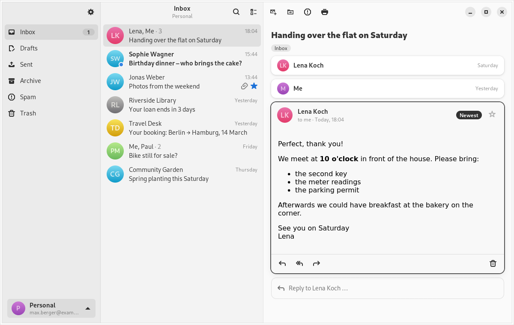
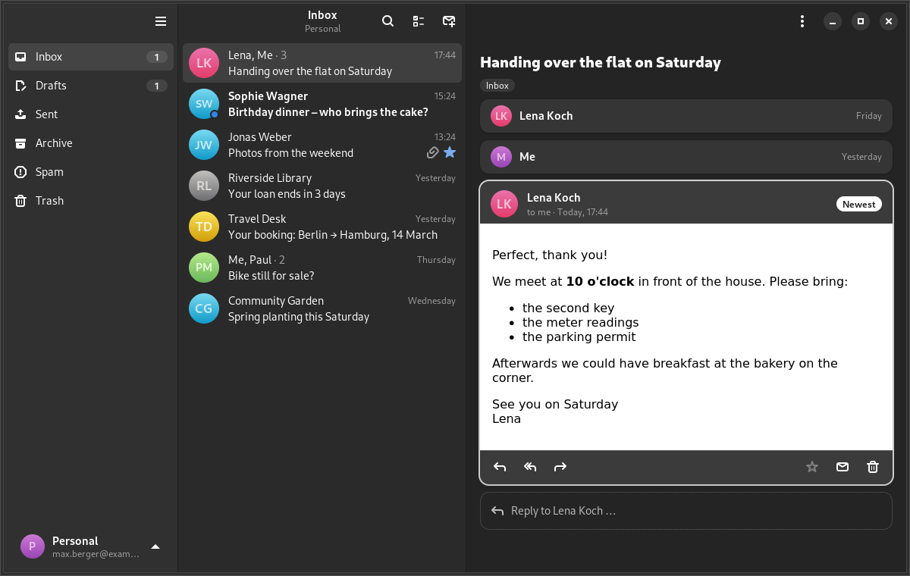
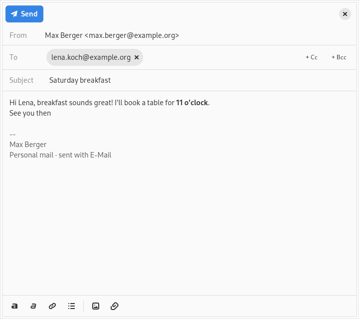
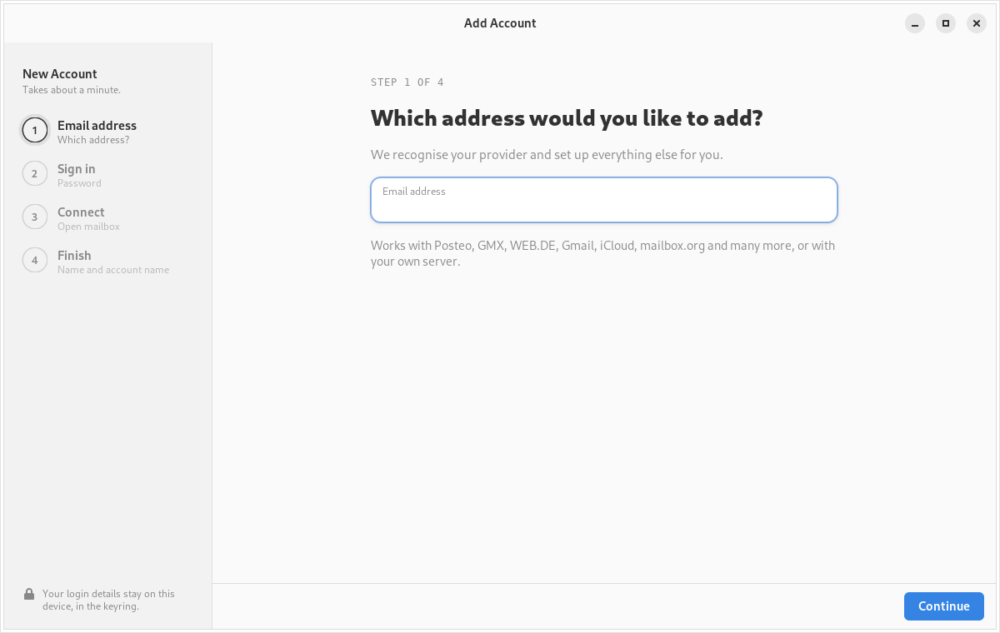

[English](README.md) · **Deutsch**


# E-Mail – die moderne E-Mail-App für Linux

Eine einfache, moderne E-Mail-App für Linux (GNOME und KDE), geschrieben in Rust mit GTK 4 und libadwaita.

Mehrere Konten, IMAP und SMTP, sonst nichts: kein Kalender, kein Chat, keine Kontaktverwaltung.

**Aktuelle Version: 1.0.2**



<p>
  
  
</p>
<p>
  
</p>

## Funktionen

- **Mehrere Konten, strikt getrennt:** jedes Konto für sich, ohne gemeinsamen Posteingang. Die geführte Einrichtung erkennt den Anbieter und hilft bei App-Passwörtern.
- **Unterhaltungen:** Antworten stehen direkt unter der Nachricht, die neueste ist hervorgehoben. Verschieben, Spam und Drucken sind mit einem Klick über der Leseansicht erreichbar, die die ganze Fensterbreite nutzt.
- **Schreiben:** neue Mails im eigenen Fenster, Formatierung, Bilder im Text, Anhänge und eine Signatur pro Konto. Entwürfe werden automatisch gespeichert, und was ohne Internet geschrieben wird, geht raus, sobald die Verbindung wieder steht.
- **Suche und Tastenkürzel:** Suche im ganzen Konto mit Filtern; `?` oder Einstellungen → Tastenkürzel zeigt alle Tastenkürzel. Das Zahnrad oben in der Ordnerleiste öffnet die Einstellungen.
- **Benachrichtigungen über das System,** auch wenn das Fenster geschlossen ist, auf Wunsch pro Konto. Im Hintergrund zeigt ein Symbol in der Leiste ungelesene Mails; unter GNOME braucht es dafür die Erweiterung „AppIndicator“ (bei Ubuntu schon dabei).
- **Privat:** Externe Bilder werden erst nach Freigabe geladen, Passwörter liegen im Schlüsselbund des Systems.
- **Sprachen:** Deutsch und Englisch.

Unterstützt werden alle Anbieter mit IMAP und SMTP, zum Beispiel Gmail, GMX, WEB.DE, iCloud, Yahoo, Posteo, mailbox.org und die meisten Firmen- und Hostingpostfächer. Microsoft-Konten (Outlook, Hotmail, Office 365) werden nicht unterstützt.

## Installieren

Die Installationsdateien liegen bei jeder Version unter [Releases](https://github.com/digistalter/email/releases/latest). Passende Datei herunterladen, ein Terminal im Download-Ordner öffnen und den Befehl für dein System ausführen. Danach erscheint „E-Mail“ in der App-Übersicht.

### Ubuntu, Debian, Linux Mint, Pop!_OS, elementary OS

Datei: `e-mail_1.0.2_amd64.deb` · für Ubuntu 24.04 und neuer, Debian 13 und neuer, Linux Mint 22 und neuer

```bash
sudo apt install ./e-mail_1.0.2_amd64.deb
```

### Fedora

Datei: `e-mail-1.0.2-1.x86_64.rpm` · für die aktuellen Fedora-Versionen

```bash
sudo dnf install ./e-mail-1.0.2-1.x86_64.rpm
```

### Alle anderen Systeme (Flatpak)

Datei: `e-mail.flatpak` · läuft auf praktisch jedem Linux, zum Beispiel openSUSE, Arch Linux, Manjaro, EndeavourOS oder ältere Ubuntu- und Debian-Versionen.

Falls Flatpak noch nicht installiert ist, zuerst einmalig:

| System | Befehl |
|---|---|
| openSUSE | `sudo zypper install flatpak` |
| Arch Linux, Manjaro, EndeavourOS | `sudo pacman -S flatpak` |
| Ubuntu, Debian | `sudo apt install flatpak` |

Dann Flathub einrichten (liefert die nötigen GNOME-Bausteine) und die App installieren:

```bash
flatpak remote-add --user --if-not-exists flathub https://dl.flathub.org/repo/flathub.flatpakrepo
```

```bash
flatpak install --user ./e-mail.flatpak
```

Starten lässt sich die App dann über die App-Übersicht oder mit `flatpak run io.github.digistalter.EMail`.

War das Flatpak von Version 1.0.0 oder 1.0.1 installiert? Seit 1.0.2 hat die App eine neue Kennung. Das alte deshalb einmal entfernen und die Konten neu einrichten (bei `.deb` und `.rpm` wird alles übernommen):

```bash
flatpak uninstall --user io.github.deviablo.EMail
```

### Tipp zum Ausprobieren

Zuerst ein Testkonto einrichten, nicht gleich das wichtigste Postfach.

### Wieder entfernen

| Installiert als | Befehl |
|---|---|
| `.deb` | `sudo apt remove e-mail` |
| `.rpm` | `sudo dnf remove e-mail` |
| Flatpak | `flatpak uninstall --user io.github.digistalter.EMail` |

## Selbst bauen

Wie man die App aus dem Quelltext baut, testet und die Pakete selbst erzeugt, steht in [`docs/ENTWICKLUNG.md`](docs/ENTWICKLUNG.md).

## Mitmachen

Fehler und Ideen bitte als [Issue](https://github.com/digistalter/email/issues) melden.

## Lizenz

E-Mail ist eine offene Community, gesponsert von der [DIGISTALTER GmbH](https://www.digistalter.de).

Dieses Programm ist freie Software: Du kannst es unter den Bedingungen der GNU General Public License, wie von der Free Software Foundation veröffentlicht, weitergeben und/oder verändern, entweder gemäß Version 3 der Lizenz oder (nach deiner Wahl) jeder späteren Version.

Dieses Programm wird in der Hoffnung verbreitet, dass es nützlich ist, aber **ohne jede Gewährleistung**, sogar ohne die implizite Gewährleistung der Marktreife oder der Eignung für einen bestimmten Zweck. Details stehen in der GNU General Public License.

Den vollständigen Lizenztext findest du in der Datei [`LICENSE`](LICENSE).

`SPDX-License-Identifier: GPL-3.0-or-later`
