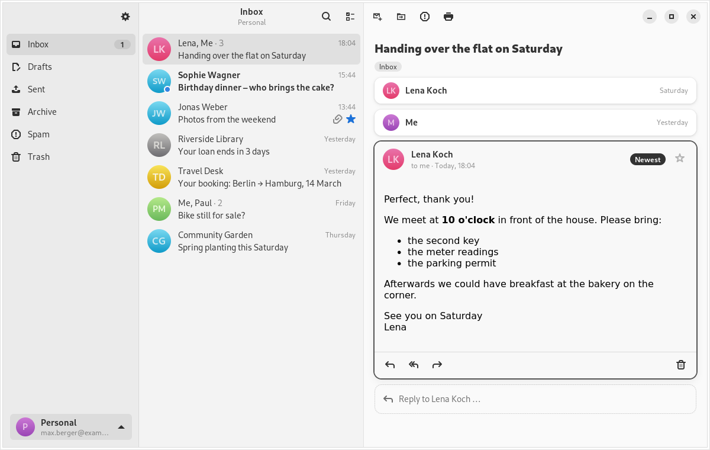
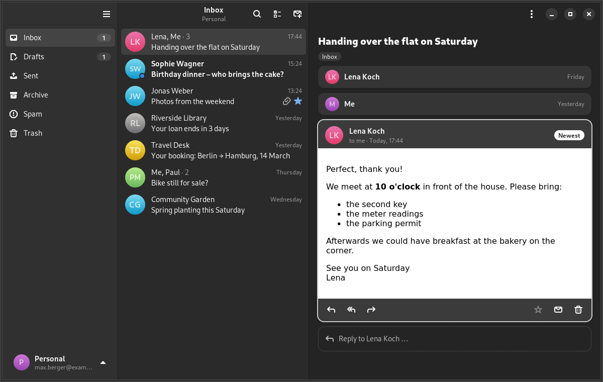
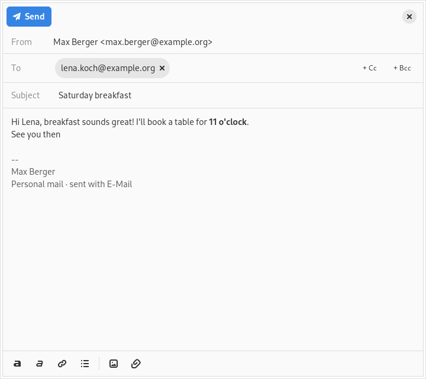
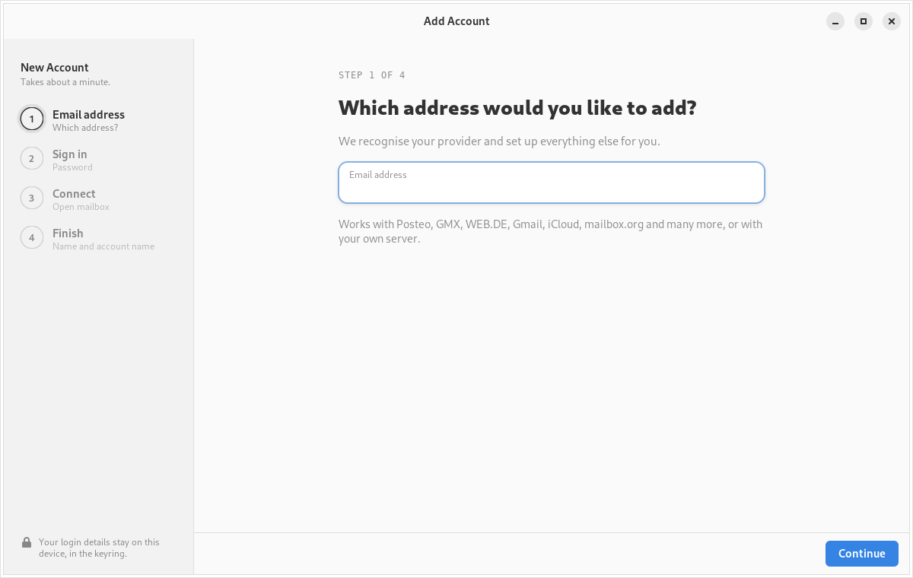

**English** · [Deutsch](README.de.md)


# E-Mail – the modern email app for Linux

A simple, modern email client for Linux (GNOME and KDE), written in Rust with GTK 4 and libadwaita.

Several accounts, IMAP and SMTP, nothing else: no calendar, no chat, no contact management.

**Current version: 1.0.1**



<p>
  
  
</p>
<p>
  
</p>

## Features

- **Several accounts, strictly separate:** every account on its own, without a shared inbox. The guided setup recognises your provider and helps with app passwords.
- **Conversations:** replies sit right below the message, the newest one stands out. Move, spam and print are one click away above the reading pane, which uses the whole width of the window.
- **Writing:** new messages in their own window, formatting, pictures in the text, attachments and one signature per account. Drafts are saved automatically, and what you write while offline is sent as soon as you are connected again.
- **Search and keyboard shortcuts:** search the whole account with filters; `?` or Settings → Keyboard Shortcuts shows all shortcuts. The gear at the top of the folder sidebar opens the settings.
- **Notifications through the system,** also with the window closed, per account if you like. In the background an icon in the panel shows unread mail; on GNOME this needs the “AppIndicator” extension (included in Ubuntu).
- **Private:** external images load only after you allow them, passwords live in the system keyring.
- **Languages:** English and German.

Every provider with IMAP and SMTP works, for example Gmail, GMX, WEB.DE, iCloud, Yahoo, Posteo, mailbox.org and most company and hosting mailboxes. Microsoft accounts (Outlook, Hotmail, Office 365) are not supported.

## Install

The installation files for every version are under [Releases](https://github.com/deviablo/email/releases/latest). Download the file for your system, open a terminal in the download folder and run the command for your system. “E-Mail” then shows up in your app overview.

### Ubuntu, Debian, Linux Mint, Pop!_OS, elementary OS

File: `e-mail_1.0.1_amd64.deb` · for Ubuntu 24.04 and newer, Debian 13 and newer, Linux Mint 22 and newer

```bash
sudo apt install ./e-mail_1.0.1_amd64.deb
```

### Fedora

File: `e-mail-1.0.1-1.x86_64.rpm` · for the current Fedora releases

```bash
sudo dnf install ./e-mail-1.0.1-1.x86_64.rpm
```

### All other systems (Flatpak)

File: `e-mail.flatpak` · runs on practically every Linux, for example openSUSE, Arch Linux, Manjaro, EndeavourOS or older Ubuntu and Debian releases.

If Flatpak is not installed yet, do this once first:

| System | Command |
|---|---|
| openSUSE | `sudo zypper install flatpak` |
| Arch Linux, Manjaro, EndeavourOS | `sudo pacman -S flatpak` |
| Ubuntu, Debian | `sudo apt install flatpak` |

Then add Flathub (it provides the GNOME building blocks) and install the app:

```bash
flatpak remote-add --user --if-not-exists flathub https://dl.flathub.org/repo/flathub.flatpakrepo
```

```bash
flatpak install --user ./e-mail.flatpak
```

Start the app from your app overview or with `flatpak run io.github.deviablo.EMail`.

### Tip for trying it out

Set up a test account first, not your most important mailbox.

### Uninstall

| Installed as | Command |
|---|---|
| `.deb` | `sudo apt remove e-mail` |
| `.rpm` | `sudo dnf remove e-mail` |
| Flatpak | `flatpak uninstall --user io.github.deviablo.EMail` |

## Build it yourself

How to build the app from source, run the tests and make the packages yourself is described in [`docs/ENTWICKLUNG.md`](docs/ENTWICKLUNG.md) (in German).

## Contributing

Please report bugs and ideas as an [issue](https://github.com/deviablo/email/issues).

## License

E-Mail is an open community sponsored by [DIGISTALTER GmbH](https://www.digistalter.de).

This program is free software: you can redistribute it and/or modify it under the terms of the GNU General Public License as published by the Free Software Foundation, either version 3 of the License, or (at your option) any later version.

This program is distributed in the hope that it will be useful, but **without any warranty**; without even the implied warranty of merchantability or fitness for a particular purpose. See the GNU General Public License for more details.

The full license text is in the file [`LICENSE`](LICENSE).

`SPDX-License-Identifier: GPL-3.0-or-later`
